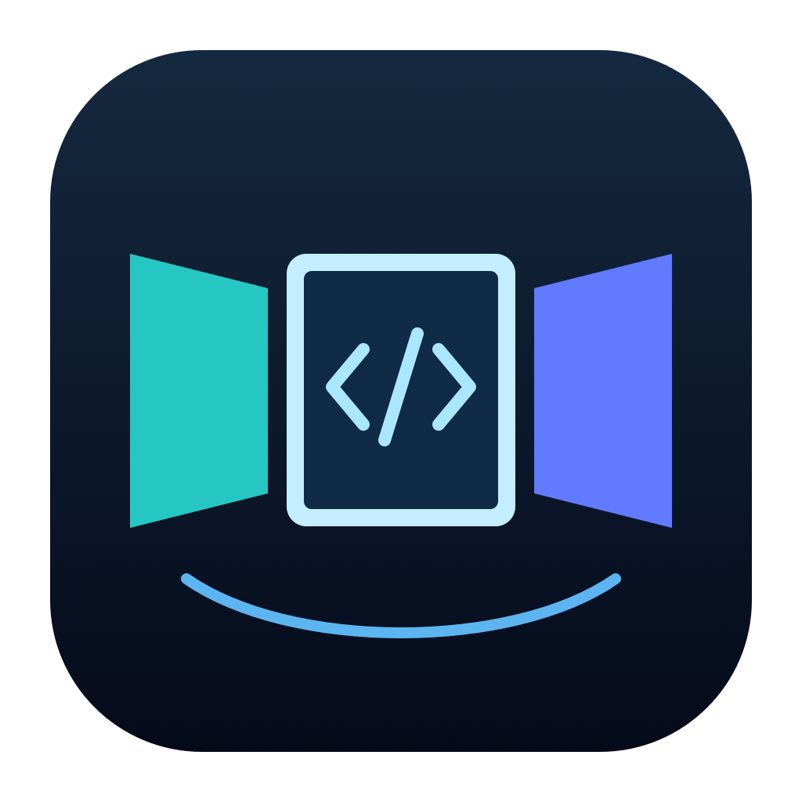

# RayNeo GT Mac Workspace



[Italiano](LEGGIMI-ITALIANO.md) · [简体中文 / historical guide](README.zh-CN.md)

**A native spatial workspace for macOS: one, two or three independent desktops in RayNeo GT glasses, with head tracking and an experimental iPhone remote.**

Version **0.11.0 — development preview**. The current Mac interface uses SwiftUI and AppKit, with optional Liquid Glass. The interface is currently in Italian. Earlier GT sessions were reported working; the current version still needs a complete hardware acceptance run. This is an independent community project, unaffiliated with RayNeo or Apple.

## Features

- Cinema, Doppio and Trio presets: 1–3 independent 1920 × 1080 virtual displays.
- Gyroscope head tracking, startup bias calibration, recentering and optional drift correction. No absolute positioning or 6DoF tracking is claimed.
- Native macOS windows, mouse, keyboard, scrolling and dragging across desktops.
- Live workspace view and 3D layout preview on the Mac; screen size, distance, spacing, brightness and background controls.
- Focus lock, cursor recall, monitor radar and a quick panel with a virtual keyboard.
- Window recovery within the current app process, when the original windows still exist.
- Experimental iPhone/iPad client: encrypted H.264 video, monitor selection, trackpad, text input and an external-display scene. Remote head tracking is not implemented.

## Compatibility

| Component | Requirement / status |
| --- | --- |
| Mac host | Apple Silicon (arm64), macOS 26.0+. M2 has historical test reports; other chips and the complete 0.11.0 hardware flow remain unverified. Intel is not a build target. |
| Glasses | RayNeo GT via video-capable USB-C, in Follow mode. Tracker matches USB VID `3941`, PID `AF50`. Other RayNeo, XREAL, VITURE and Rokid models have no implemented tracking support. |
| Build tools | Xcode with macOS 26+ SDK; iOS SDK for the companion; Python 3 for helper scripts. No third-party package dependencies. |
| iPhone/iPad client | iOS/iPadOS 17.0+. Client compilation does not prove device compatibility. External video requires a device that supports video output, not merely a USB-C connector. |
| Windows / Android | No app or build target. |

Read the [device matrix](docs/COMPATIBILITY.md) before buying hardware. Basic video output and this app's head tracking are separate capabilities.

## Build and try

Download this repository's source ZIP and extract it, or clone it:

```sh
git clone https://github.com/mrpalmeri0/rayneo-gt-mac-workspace.git
cd rayneo-gt-mac-workspace
```

Run these commands from its root:

```sh
xcodebuild -version
SIGNING_IDENTITY=- bash build.sh
open build/dev/RayNeoWorkspace-Dev.app
```

This creates a locally ad hoc signed trial, not a notarized public release. Rebuilds can trigger screen recording authorization again. For daily development, use a stable identity: [signing](docs/SIGNING.md).

Alternatively, open `RayNeoWorkspace.xcodeproj`. Shared schemes:

| Scheme | Purpose |
| --- | --- |
| `RayNeoWorkspace` | Native Mac host; local signing configuration required to run from Xcode. |
| `RayNeoRemote` | iPhone/iPad client; select your own Team and a unique bundle ID before installing on a physical device. |

Build without signing for compilation checks:

```sh
xcodebuild -project RayNeoWorkspace.xcodeproj -scheme RayNeoWorkspace \
  -destination 'platform=macOS,arch=arm64' -derivedDataPath build/xcode-mac CODE_SIGNING_ALLOWED=NO build
xcodebuild -project RayNeoWorkspace.xcodeproj -scheme RayNeoRemote \
  -sdk iphonesimulator -destination 'generic/platform=iOS Simulator' \
  -derivedDataPath build/xcode-iphone CODE_SIGNING_ALLOWED=NO build
```

## First session

1. Quit other copies of the app. Connect the GT directly to the Mac using a video-capable cable and choose Follow mode on the glasses.
2. Open the app, choose Cinema, Doppio or Trio, and press **Avvia sessione**.
3. Grant **Screen & System Audio Recording** in System Settings → Privacy & Security. The app captures no audio. Reopen if macOS requests it.
4. Keep the glasses still for at least two seconds; calibration also needs enough valid IMU samples. Wait until tracking reports active.
5. Place real app windows on the virtual desktops and turn your head horizontally. Use **Ricentra** whenever needed.
6. Press Stop before disconnecting to restore the display layout. Reopen controls with **⌘0** or the Dock icon.

Normal input needs no Accessibility grant. Window-moving commands, synthetic keys and remote control do. For concrete workflows and the companion setup, see [examples](docs/EXAMPLES.md).

## Shortcuts

| Shortcut | Action |
| --- | --- |
| ⌘0 | Show Mac controls |
| ⌘⌥1 / 2 / 3 | Move focused window to virtual display |
| ⌘⌥0 | Move focused window back to the Mac |
| ⌘⌥P | Move cursor to the display nearest the viewing direction |
| ⌘⌥M | Show temporary monitor radar |
| ⌘⌥K | Show quick panel |
| ⌘⌥F | Toggle Focus lock |

## Privacy and limitations

Processing stays on the Mac unless you explicitly enable remote sharing. Sharing is initially off; enabling it generates a new pairing secret. The companion uses TLS 1.2 with PSK on TCP port 9847 and admits one client. The pairing code grants desktop access: do not include it in issues or screenshots. Use an existing private VPN for access away from home; do not forward the port to the Internet.

The app saves settings and diagnostics in `~/Library/Application Support/RayNeoWorkspace-Dev/`; it does not record screen video or audio. Custom background paths may contain personal filenames. Remove personal information before submitting diagnostics. See [security and privacy](SECURITY.md).

Virtual displays rely on private `CGVirtualDisplay` APIs. Future macOS updates can break them. Gyro integration can drift; reconnect, sleep/wake, long sessions, remote TLS/video and current UI behavior need device testing. H.264 1080p/30 fps at 8 Mbit/s is a configured target, not a measured result. No firmware is flashed.

## Development and documentation

```sh
bash Tests/run-tests.sh
bash Tests/run-remote-tests.sh
bash Tests/run-texture-test.sh   # requires a working Metal device
python3 scripts/package-source.py
```

The source package includes both targets, shared code, project, configuration, examples and docs. It excludes build products and signing secrets. See [release checks](docs/GITHUB_PUBLICATION.md) for publication status and validation results.

| Guide | Content |
| --- | --- |
| [Italian guide](LEGGIMI-ITALIANO.md) | Setup and current project summary |
| [Compatibility](docs/COMPATIBILITY.md) | Devices, cables and verification levels |
| [Examples](docs/EXAMPLES.md) | Coding, cinema, focus and remote sessions |
| [Native app](docs/NATIVE_APP.md) | Architecture, features and hardware checklist |
| [Architecture](docs/ARCHITECTURE.md) | Original engine architecture; historical Chinese documentation |
| [Roadmap](docs/ROADMAP.md) | Implemented features and remaining work |
| [Contributing](CONTRIBUTING.md) | Development and issue reports |
| [Changelog](CHANGELOG.md) | Version history |
| [Credits and licensing status](NOTICE.md) | Source provenance; no license grant is assumed |
| [GitHub publication](docs/GITHUB_PUBLICATION.md) | Independent repository and source vs binary release |

Older Chinese guides describe the original 0.10.x baseline. For current behavior, use this README and the 0.11.0 guides above.
