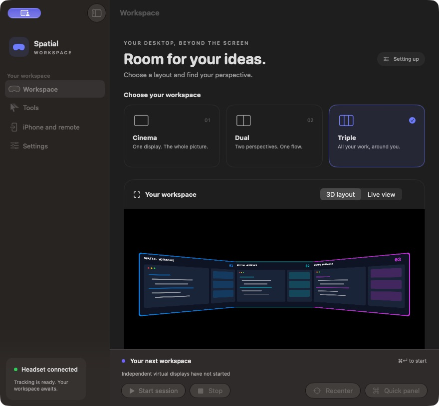
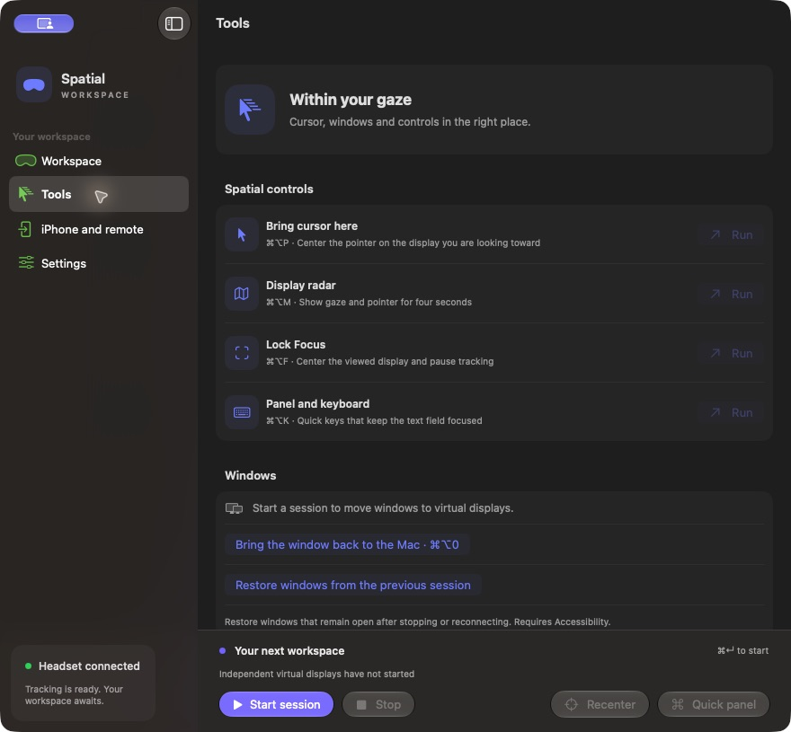
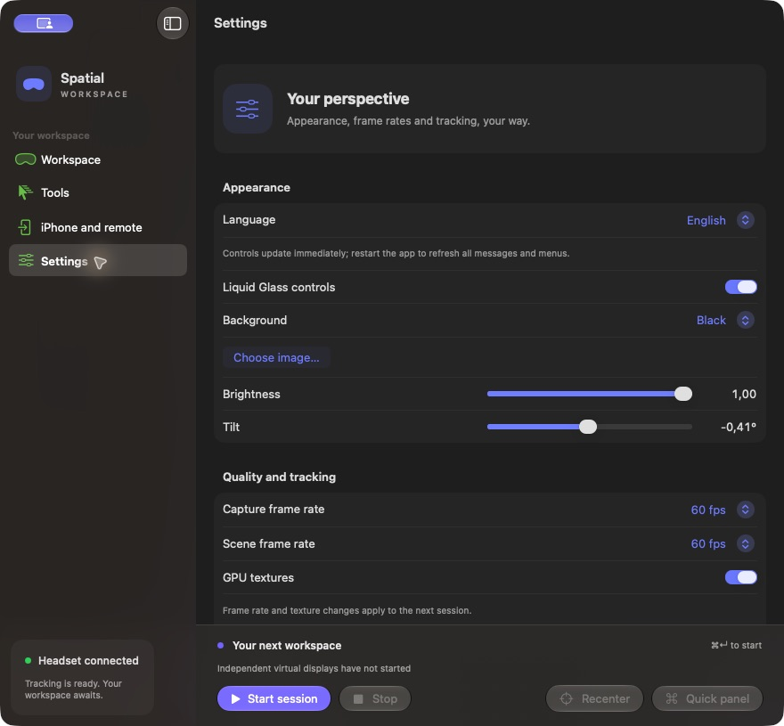

# Screens and workflows

[Italiano](../it/guide.md) · [README](../../README.md)

These are screenshots of the actual idle interface. The scene is a layout preview with illustrative desktop content, not a capture of a working headset session or measured remote stream.

## Code across three desktops

Choose Triple before starting. Place documentation on display 1, Xcode on display 2 and Terminal on display 3. With Accessibility enabled, select each window and use ⌘⌥1/2/3. Turn your head to consult a side display. ⌘⌥P recalls the cursor to the display nearest your viewing direction; ordinary mouse movement also works. ⌘⌥0 returns a window to the Mac. Fullscreen apps and apps limiting Accessibility may resist window placement.

## Cinema, Dual and live view

Cinema uses one display and disables tracking in its preset. Dual places two desktops side by side. Layout 3D previews their arrangement. Live view uses the glasses scene/camera during an active session; it does not create extra desktops itself. Stop before changing display count.

## Focus and quick panel

⌘⌥F centers the viewed display and locks the camera; press it again to restore the prior tracking/pause state. ⌘⌥M shows gaze/pointer radar for four seconds. ⌘⌥K opens the non-activating quick panel. Select a text field in the destination app first, then use its keys. Synthetic input requires Accessibility. Window restoration keeps still-open windows within the running process, not across app termination.

## iPhone remote

Enable sharing on the Mac under iPhone and remote. Install scheme `RayNeoRemote` on your device using your own Xcode Team and bundle ID. On the same Wi-Fi network, paste the code generated by the Mac. Format: `host:9847#GENERATED_SECRET` — this example is not a working credential. If name lookup fails, replace only the host with the Mac's reachable IP.

Select a monitor and use the phone's trackpad, scrolling, text and quick keys. A compatible USB-C video device can show the external scene in glasses. For access away from home use an existing private VPN. Mac must stay awake with a user session open. The client disconnects when backgrounded; reconnect manually. Sharing off/on rotates the secret. No audio streaming or iOS head tracking is implemented. The complete remote workflow still needs device acceptance.

## Example presets

[Presets](../../examples/README.md) provide complete JSON starting points; there is no in-app file import.
