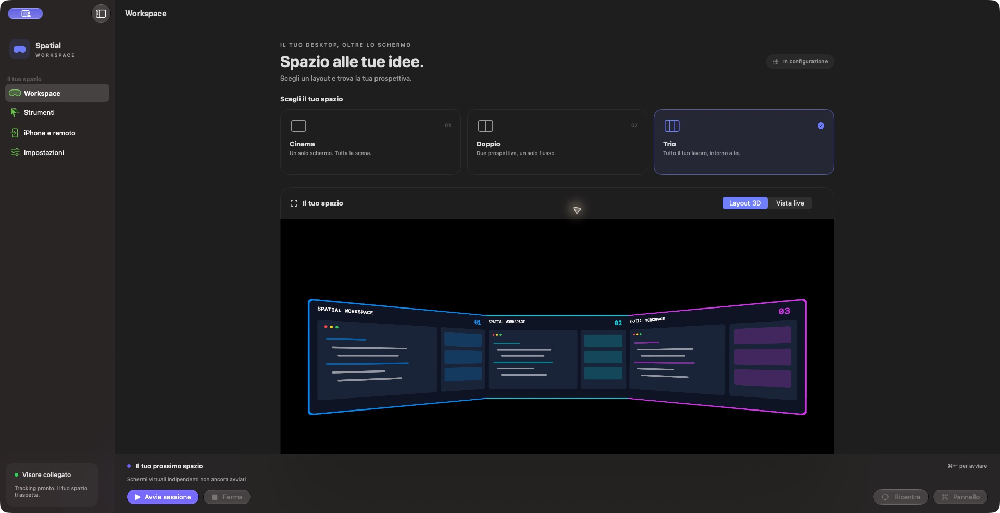
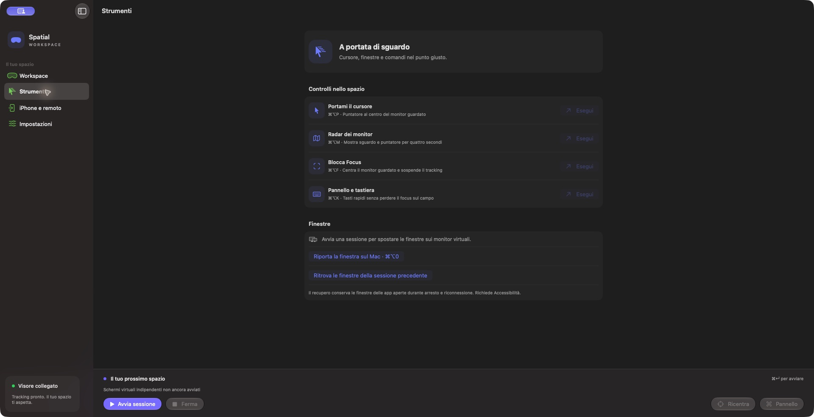
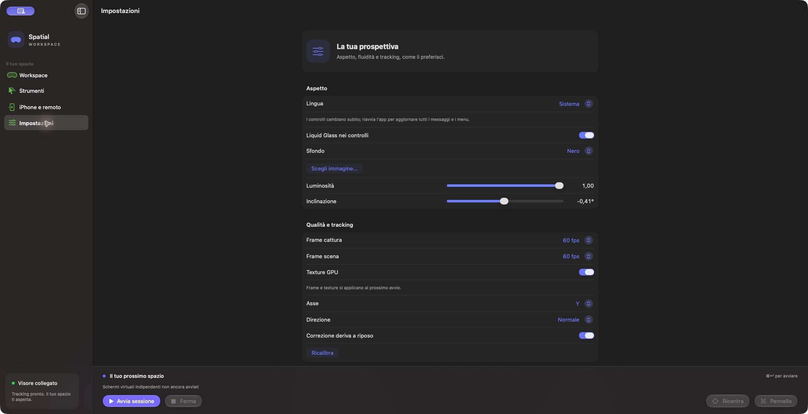

# Schermate e flussi d'uso

[English](../en/guide.md) · [README](../../README.it.md)

Le immagini mostrano l'interfaccia reale a sessione ferma. La scena è un'anteprima del layout con contenuto illustrativo: non è una cattura di una sessione GT funzionante né una misura del flusso remoto.

## Programmare su tre desktop

Seleziona Trio prima di avviare. Disponi documentazione sul monitor 1, Xcode sul 2 e Terminale sul 3. Con Accessibilità abilitata seleziona ogni finestra e usa ⌘⌥1/2/3. Gira la testa per consultare uno schermo laterale. ⌘⌥P porta il cursore sul monitor più vicino allo sguardo; puoi anche muoverlo normalmente. ⌘⌥0 riporta la finestra sul Mac. Fullscreen e app che limitano Accessibilità possono impedire il posizionamento.

## Cinema, Doppio e vista live

Cinema usa uno schermo e nel preset disattiva il tracking. Doppio affianca due desktop. Layout 3D mostra la disposizione. Vista live usa scena/camera degli occhiali durante la sessione; non crea altri desktop. Ferma la sessione prima di cambiare il numero di monitor.

## Focus e pannello rapido

⌘⌥F centra il monitor guardato e blocca la camera; premilo ancora per ripristinare lo stato precedente di tracking/pausa. ⌘⌥M mostra radar sguardo/puntatore per quattro secondi. ⌘⌥K apre il pannello non attivante. Seleziona prima un campo nell'app di destinazione, poi usa i tasti. L'input sintetico richiede Accessibilità. Il recupero conserva finestre ancora aperte all'interno del processo, non dopo l'uscita dall'app.

## Remoto iPhone

Sul Mac abilita la condivisione in iPhone e remoto. Installa lo schema `RayNeoRemote` sul dispositivo configurando Team Xcode e bundle ID tuoi. Sulla stessa rete Wi-Fi incolla il codice generato dal Mac. Formato: `host:9847#CHIAVE_GENERATA` — non è una credenziale funzionante. Se il nome non si risolve sostituisci soltanto l'host con l'IP raggiungibile del Mac.

Seleziona un monitor e usa trackpad, scroll, testo e tasti del telefono. Un dispositivo USB-C con video compatibile può mostrare la scena esterna negli occhiali. Fuori casa usa una VPN privata esistente. Il Mac deve restare sveglio e con sessione utente aperta. Il client si disconnette in background e va riconnesso manualmente. Disattivare/riattivare la condivisione cambia il codice. Streaming audio e tracking testa iOS non sono implementati. Il flusso remoto completo richiede ancora collaudo.

## Preset di esempio

I [preset](../../examples/README.it.md) sono esempi JSON completi; non esiste un pulsante di importazione nell’app.
